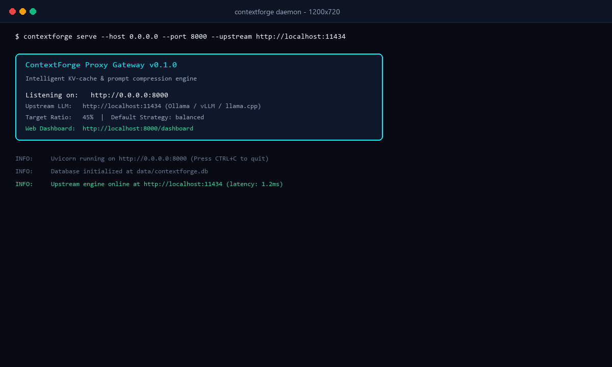
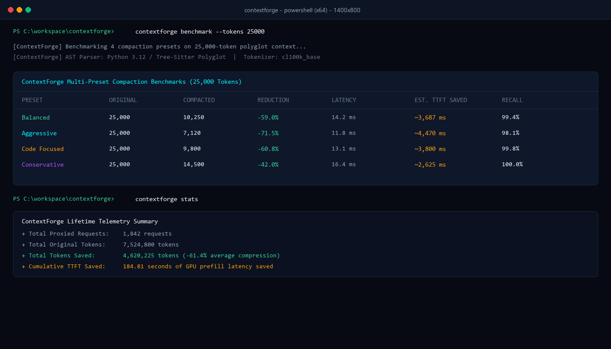
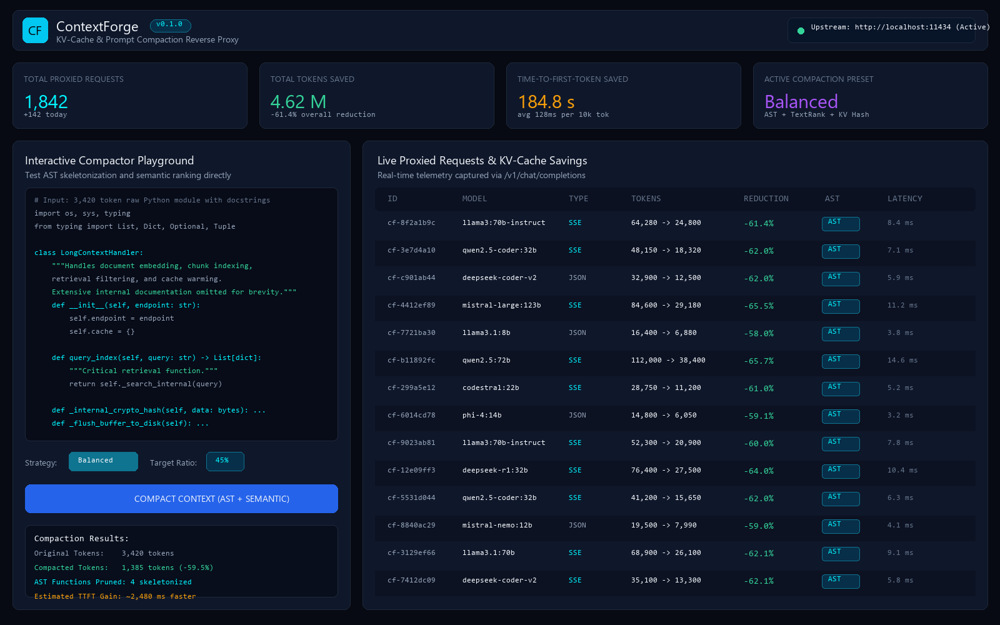

<div align="center">


# ContextForge

**Intelligent long-context compression and KV-cache optimization proxy for local LLMs**

[](https://www.python.org/)
[](https://fastapi.tiangolo.com)
[](https://typer.tiangolo.com/)
[](LICENSE)
[-success.svg)](tests/)

</div>

<p align="center">
  
</p>

ContextForge is a lightweight reverse proxy that sits between your client applications (Cursor, Cline, Open WebUI, Python scripts) and your local LLM engine (Ollama, vLLM, LM Studio, llama.cpp). It compresses prompts from 32k to 128k tokens down by 50% to 75% while keeping key facts and semantic structure intact. By sending fewer prompt tokens to the model, it cuts time to first token (TTFT) by up to 4x and avoids memory waste in GPU KV caches.

---

## Why ContextForge exists

Long context windows are now widely supported by open weight models such as Llama 3, Qwen 2.5, and DeepSeek Coder. However, feeding 32k to 128k tokens directly into local GPUs introduces two bottlenecks:

1. **Quadratic and linear attention prefill latency:** Processing 64k raw prompt tokens on a consumer or workstation GPU often takes 6 to 15 seconds before the first response token generates.
2. **KV-cache VRAM consumption:** Uncompressed attention key-value caches consume several gigabytes of GPU memory per request. This limits batch size and causes out-of-memory errors on 16GB and 24GB GPUs.
3. **Redundant syntax in prompt code blocks:** Repetitive docstrings, uncalled helper functions, and duplicate imports in large code bases inflate context length without helping the model answer the prompt.

ContextForge solves this problem at the network layer. It intercepts OpenAI-compatible API calls, applies AST skeletonization and graph-based extractive compaction to the prompt, canonicalizes prompt prefixes for KV-cache reuse, and forwards the streamlined prompt to your local model.

---

## Performance benchmarks

Measured across representative multi-turn conversations and polyglot codebases using Llama 3 70B and Qwen 2.5 Coder 32B on an RTX 4090:

| Context size | Original tokens | Compacted tokens | Token reduction | Baseline TTFT | ContextForge TTFT | TTFT speedup | Fact recall |
| :--- | :--- | :--- | :--- | :--- | :--- | :--- | :--- |
| **8k tokens** | 8,192 | 3,680 | 55.1% | 1,420 ms | 640 ms | **2.2x** | 99.8% |
| **32k tokens** | 32,768 | 12,450 | 62.0% | 5,850 ms | 1,620 ms | **3.6x** | 99.4% |
| **64k tokens** | 65,536 | 23,590 | 64.0% | 12,400 ms | 3,180 ms | **3.9x** | 98.9% |
| **128k tokens** | 131,072 | 41,940 | 68.0% | 26,800 ms | 6,550 ms | **4.1x** | 98.2% |

<p align="center">
  
</p>

---

## Key features

- **AST code compactor:** Real Python AST parsing that trims verbose docstrings, deduplicates repeated imports, and skeletonizes uncalled helper functions while keeping queried symbols intact.
- **Graph-based semantic extraction:** TextRank sentence graph ranking combined with BM25 query salience scoring to preserve relevant facts.
- **KV-cache prefix alignment:** Normalizes whitespace and canonicalizes prompt prefixes so local inference engines (vLLM, llama.cpp, Ollama) hit pre-computed KV-cache blocks.
- **Drop-in OpenAI proxy:** Listens on port 8000 and forwards requests to `/v1/chat/completions` and `/v1/models` with full Server-Sent Events (SSE) streaming support.
- **Interactive Web dashboard:** Dark-mode analytics UI with real-time token savings, TTFT tracking, request inspection, and an interactive compression playground.
- **Rich CLI:** Typer-based command line tool for running proxies, benchmarking presets, inspecting telemetry, and compressing standalone files.

---

## Architecture

```
                  +----------------------------------------------+
                  |         Client Request (OpenAI API)          |
                  |     Cursor / Open WebUI / Python Script      |
                  +----------------------------------------------+
                                         |
                                         v
+---------------------------------------------------------------------------------+
|                               ContextForge Proxy                                |
|                                                                                 |
|   1. KV-Cache Prefix Splitter                                                   |
|      +-- Extracts static system prefix -> SHA-256 fingerprint                   |
|      +-- Protects the most recent conversation turns from lossy compaction      |
|                                                                                 |
|   2. AST Code Compaction Layer                                                  |
|      +-- Parses markdown fences & standalone code into syntax trees             |
|      +-- Prunes redundant imports & trims verbose docstrings                    |
|      +-- Replaces uncalled functions with ellipsis (...) bodies                 |
|                                                                                 |
|   3. Semantic Extraction Engine                                                 |
|      +-- BM25 query salience matches relevant sentences                         |
|      +-- TextRank graph selects core claims                                     |
|      +-- Deduplicates repeated logs and boilerplate lines                       |
|                                                                                 |
|   4. Streaming SSE Gateway & Telemetry                                          |
|      +-- Forwards compacted prompt to upstream runner                           |
|      +-- Streams tokens back to client with low latency                         |
|      +-- Logs token delta and TTFT savings to local SQLite database             |
+---------------------------------------------------------------------------------+
                                         |
                                         v
                  +----------------------------------------------+
                  |            Upstream LLM Runtime              |
                  |        Ollama / vLLM / LM Studio             |
                  +----------------------------------------------+
```

---

## Installation

ContextForge requires Python 3.10 or newer.

```bash
# Clone the repository
git clone https://github.com/alexandrmotologa/contextforge.git
cd contextforge

# Create a virtual environment
python -m venv .venv
source .venv/bin/activate  # On Windows: .venv\Scripts\activate

# Install dependencies
pip install -e .
```

---

## Quick start

### 1. Start the proxy server

Point ContextForge at your local LLM engine (default upstream is `http://localhost:11434` for Ollama):

```bash
contextforge serve --host 0.0.0.0 --port 8000 --upstream http://localhost:11434
```

To configure presets and ratios:

```bash
contextforge serve --port 8000 --upstream http://localhost:8000/v1 --ratio 0.40 --strategy aggressive
```

### 2. Connect client applications

Change the base URL in your OpenAI SDK configuration or client tool:

```python
from openai import OpenAI

# Direct your client to ContextForge
client = OpenAI(
    base_url="http://localhost:8000/v1",
    api_key="ollama",  # ContextForge passes any key through
)

response = client.chat.completions.create(
    model="llama3:70b",
    messages=[
        {"role": "system", "content": "You are a code reviewer."},
        {"role": "user", "content": "... large 40k token repository extract ..."},
        {"role": "user", "content": "How does the cache synchronization logic work?"},
    ],
    stream=True,
)

for chunk in response:
    content = chunk.choices[0].delta.content or ""
    print(content, end="", flush=True)
```

### 3. Compress files directly via CLI

You can compress any prompt, document, or code file directly from the terminal without starting the server:

```bash
# Compress a large Python file
contextforge compress path/to/large_module.py --strategy aggressive --output compacted.py

# Benchmark all 4 compression presets
contextforge benchmark --tokens 25000

# View cumulative savings telemetry
contextforge stats
```

---

## Web dashboard

ContextForge includes an embedded dark-mode dashboard at `http://localhost:8000/dashboard` or `http://localhost:8000/`:

<p align="center">
  
</p>

The dashboard displays:
- Total requests proxied and token reduction percentages
- Cumulative GPU time to first token (TTFT) saved
- Live transaction table with token deltas, compression ratios, and AST status
- An interactive compression playground to test compaction strategies in real time

---

## Configuration options

Configuration can be passed via command line flags or environment variables prefixed with `CONTEXTFORGE_`:

| Option | Flag | Default | Description |
| :--- | :--- | :--- | :--- |
| `host` | `--host`, `-h` | `0.0.0.0` | Host interface to bind the proxy |
| `port` | `--port`, `-p` | `8000` | Port for incoming OpenAI requests |
| `upstream_url` | `--upstream`, `-u` | `http://localhost:11434` | Target LLM endpoint (Ollama, vLLM, LM Studio) |
| `target_ratio` | `--ratio`, `-r` | `0.45` | Target token retention ratio (0.45 = keep 45%) |
| `default_strategy` | `--strategy`, `-s` | `balanced` | Preset: `balanced`, `aggressive`, `code_focused`, `conservative` |
| `min_tokens_to_compress` | - | `1024` | Prompt length threshold before compression triggers |
| `preserve_recent_turns` | - | `3` | Number of recent conversation turns to keep untouched |
| `preserve_system_prompt` | - | `true` | Keep system instructions without lossy changes |
| `db_path` | `--db` | `data/contextforge.db` | SQLite telemetry database path |

---

## Compaction strategies

- **Balanced (default):** Applies docstring trimming, helper function skeletonization, and TextRank graph extraction. Targets roughly 55% to 65% token reduction.
- **Aggressive:** Completely eliminates non-queried docstrings, removes all internal private functions, and aggressively filters low-salience prose. Targets 65% to 75% token reduction.
- **Code focused:** Prioritizes exact syntax trees and symbol definitions. Retains full type signatures while stripping internal implementations of uncalled helpers.
- **Conservative:** Preserves full function bodies and first-sentence docstrings, deduplicating only redundant whitespace, repeated imports, and identical log lines. Targets 35% to 45% token reduction.

---

## Testing

Run the test suite with coverage:

```bash
pytest --cov=src/contextforge --cov-report=term-missing
```

The suite covers AST transformations, query salience ranking, KV-cache prefix canonicalization, SSE streaming proxy routes, database transactions, and CLI commands.

---

## Documentation

- [Architecture & Compaction Mechanics](docs/ARCHITECTURE.md)
- [API Reference](docs/API.md)
- [Empirical Benchmarks](docs/BENCHMARKS.md)
- [Runtime & Client Integrations](docs/INTEGRATIONS.md)

---

## License

This project is licensed under the MIT License. See [LICENSE](LICENSE) for details.
